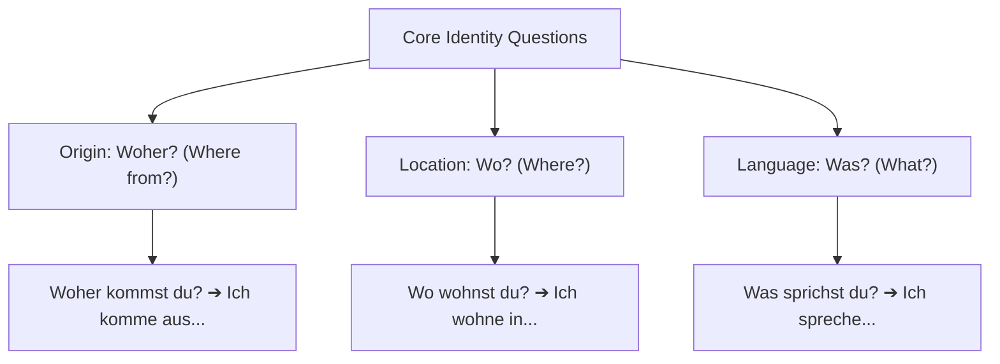

# 🇩🇪 Day 02: Personal Identity, Origins & The Verb Conjugation Engine

- **Date:** Tuesday, 17 Nov 2026  
- **Streak:** 🔥 **Day 2**  
- **Level:** Level 0 → A1.1  
- **Focus:** Asking & Answering Identity Questions (*Woher*, *Wo*, *Was*), Verb Conjugation (*-e, -st, -t, -en*) & Survival Politeness  

---

## 🎯 Today's Goals
1. Learn how to tell someone your country of origin and current city.
2. Crack the **Present Tense Verb Conjugation Engine** (the formula for almost all German verbs!).
3. Understand the difference between informal (*du*) and formal (*Sie*).
4. Master essential everyday polite words (*Bitte*, *Danke*, *Entschuldigung*).

---

## Part 1: Identity & Origins (Asking & Answering)

In German, questions asking for information (Who, What, Where) start with a **W** and are called **W-Fragen**.

### 1. Where do you come from? (Origin)
- **Question (Casual):** *Woher kommst du?* (vo-HAIR komst doo?)
- **Question (Formal):** *Woher kommen Sie?* (vo-HAIR kom-en zee?)
- **Formula:**
  $$\text{Ich komme aus } [\text{Country / City}]$$
- **Examples:**
  - *Ich komme aus Bangladesch.* (I come from Bangladesh.)
  - *Ich komme aus Deutschland.* (I come from Germany.)
  - *Ich komme aus den USA.* (I come from the USA — note: some countries take an article!)

### 2. Where do you live? (Residence)
- **Question (Casual):** *Wo wohnst du?* (voh vohnst doo?)
- **Question (Formal):** *Wo wohnen Sie?* (voh vohn-en zee?)
- **Formula:**
  $$\text{Ich wohne in } [\text{City}]$$
- **Examples:**
  - *Ich wohne in Dhaka.* (I live in Dhaka.)
  - *Ich wohne in Berlin.* (I live in Berlin.)

### 3. What languages do you speak?
- **Question (Casual):** *Was sprichst du?* / *Welche Sprachen sprichst du?*
- **Formula:**
  $$\text{Ich spreche } [\text{Language(s)}]$$
- **Examples:**
  - *Ich spreche Englisch und Bengalisch.* (I speak English and Bengali.)
  - *Ich lerne Deutsch.* (I am learning German. *Verb: lernen*)
  - *Ich spreche ein bisschen Deutsch.* (I speak a little bit of German.)

---

## Part 2: The Verb Conjugation Engine (Regular Verbs)

Every German verb in the dictionary ends with **-en** (called the **Infinitive**).  
To use the verb with different people (*I, you, he, we...*), you simply:
1. Drop the **-en** to get the **stem**.
2. Add the person's ending.

### The Golden Formula: `e – st – t – en – t – en`

| Pronoun | English | Ending | Example: *kommen* (to come) Stem: `komm-` | Example: *wohnen* (to live) Stem: `wohn-` | Example: *lernen* (to learn) Stem: `lern-` |
| :--- | :--- | :---: | :--- | :--- | :--- |
| **ich** | I | **-e** | ich komm**e** | ich wohn**e** | ich lern**e** |
| **du** | you *(informal/friend)* | **-st** | du komm**st** | du wohn**st** | du lern**st** |
| **er / sie / es** | he / she / it | **-t** | er/sie komm**t** | er/sie wohn**t** | er/sie lern**t** |
| **wir** | we | **-en** | wir komm**en** | wir wohn**en** | wir lern**en** |
| **ihr** | you all *(plural friends)* | **-t** | ihr komm**t** | ihr wohn**t** | ihr lern**t** |
| **sie / Sie** | they / **You (formal)** | **-en** | sie/Sie komm**en** | sie/Sie wohn**en** | sie/Sie lern**en** |

> [!TIP]
> **Notice the pattern:**
> - *ich* always ends in **-e**
> - *du* always ends in **-st**
> - *wir* and formal *Sie* are the easiest: they look identical to the original infinitive!

---

## Part 3: Politeness Survival Pack (Höflichkeit)

German culture values polite phrases in daily interactions:

| German | Pronunciation | English Meaning | Usage Note |
| :--- | :--- | :--- | :--- |
| **Bitte** | BIT-teh | Please / You're welcome | Used for "please" AND responding to "thank you" |
| **Danke / Danke schön** | DAHN-keh / DAHN-keh shurn | Thank you / Thank you very much | Standard gratitude |
| **Vielen Dank** | FEE-len dahnk | Many thanks | Slightly more formal |
| **Entschuldigung!** | ent-SHOOL-dee-goong | Excuse me! / Sorry! | Getting attention or apologizing |
| **Ja / Nein** | yah / nine | Yes / No | Fundamental responses |
| **Kein Problem!** | kine pro-BLAYM | No problem! | Casual reassurance |

---

## Part 4: Mini Dialogue (Putting It All Together)

Here is a natural real-world conversation between two people meeting for the first time:

> **Lukas:** Hallo! Guten Tag!  
> **Mehedi:** Hallo! Guten Tag!  
> **Lukas:** Ich heiße Lukas. Wie heißt du?  
> **Mehedi:** Ich heiße Mehedi. Freut mich! *(Pleased to meet you!)*  
> **Lukas:** Woher kommst du, Mehedi?  
> **Mehedi:** Ich komme aus Bangladesch. Und du?  
> **Lukas:** Ich komme aus Deutschland. Wo wohnst du jetzt?  
> **Mehedi:** Ich wohne in Dhaka. Und ich lerne Deutsch!  
> **Lukas:** Sehr gut! *(Very good!)* Tschüss!  
> **Mehedi:** Tschüss, bis bald!  

---

## ✍️ Interactive Checkpoint (Day 2 Drills)

Put today's engine to work! Write your answers in chat:

1. **Fill in the correct verb ending**:
   - *ich komm____ aus Bangladesch.*
   - *Wo wohn____ du?*
   - *Wir lern____ Deutsch.*
2. **Translate to German**:
   - "I live in Dhaka and I am learning German."
3. **Word Check**:
   - If someone hands you a coffee and says *"Bitte!"*, what do you reply?
