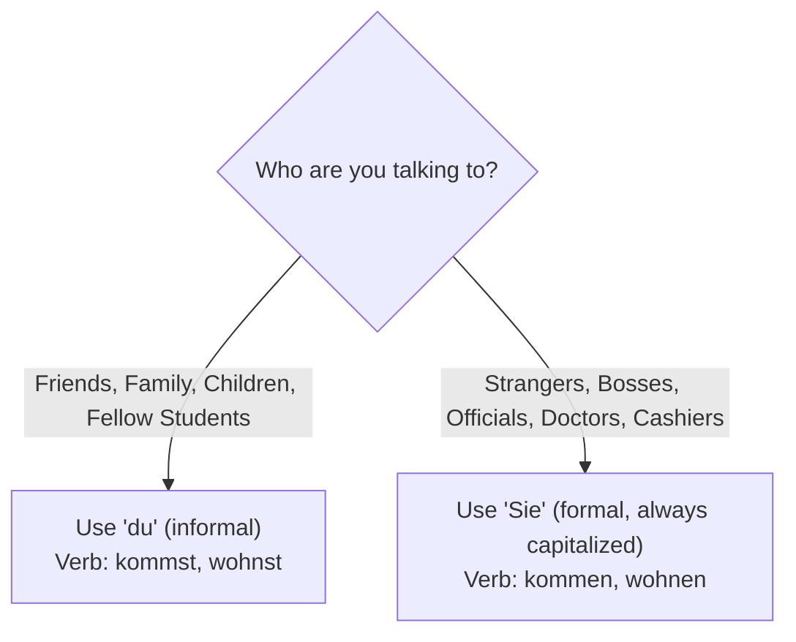

# Wednesday - 18 November 2026
# 🇩🇪 Day 03: Numbers 0–20, German Alphabet Spelling & Contact Exchange

- **Date:** Wednesday, 18 Nov 2026  
- **Streak:** 🔥 **Day 3**  
- **Level:** Level 0 → A1.1  
- **Focus:** Numbers 0–20 (*Die Zahlen*), Alphabet Spelling (*Buchstabieren*), Contact Details & Age  

---

## 🎯 Today's Goals
1. Count flawlessly from **0 to 20** in German and spot the two spelling traps (*16* and *17*).
2. Learn how to spell your name, city, and email address like a native (*Buchstabieren*).
3. State your age (*Ich bin ... Jahre alt*) and exchange phone numbers (*Meine Telefonnummer ist...*).
4. Master the social golden rule: **du** (informal) vs **Sie** (formal).

---

## Part 1: Numbers 0 to 20 (Die Zahlen 0–20)

German numbers follow a very clean mathematical logic!

### The Base Numbers (0 to 12)
| Number | German | Phonetic | English |
| :---: | :--- | :--- | :--- |
| **0** | **null** | nool | zero |
| **1** | **eins** | ynts | one |
| **2** | **zwei** | tsvye | two |
| **3** | **drei** | drye | three |
| **4** | **vier** | feer | four |
| **5** | **fünf** | foonf | five |
| **6** | **sechs** | zex | six |
| **7** | **sieben** | ZEE-ben | seven |
| **8** | **acht** | ahkht | eight |
| **9** | **neun** | noyn | nine |
| **10** | **zehn** | tsayn | ten |
| **11** | **elf** | elf | eleven |
| **12** | **zwölf** | tsvurlf | twelve |

---

### The Teens (13 to 19): The Formula `[Number] + zehn`

From 13 to 19, German simply adds **zehn** (10) to the single digit:

$$\text{Single Digit} + \text{zehn}$$

| Number | German | Breakdown | Note |
| :---: | :--- | :--- | :--- |
| **13** | **dreizehn** | drei + zehn | 3 + 10 |
| **14** | **vierzehn** | vier + zehn | 4 + 10 |
| **15** | **fünfzehn** | fünf + zehn | 5 + 10 |
| **16** | **sechzehn** | sech~~s~~ + zehn | ⚠️ **Trap:** drops the **-s** from *sechs*! |
| **17** | **siebzehn** | sieb~~en~~ + zehn | ⚠️ **Trap:** drops the **-en** from *sieben*! |
| **18** | **achtzehn** | acht + zehn | 8 + 10 |
| **19** | **neunzehn** | neun + zehn | 9 + 10 |
| **20** | **zwanzig** | TSVAHN-tsikh | twenty (*-zig* sounds like "tsikh") |

---

## Part 2: The Alphabet & Spelling (Buchstabieren)

When you register at a German city hall (*Bürgeramt*), check into a hotel, or open a bank account, you will hear:
> *"Können Sie das bitte buchstabieren?"* (Can you please spell that?)

Here are the unique German letter pronunciations:

| Letter | Pronounced as | Note / English Comparison |
| :---: | :--- | :--- |
| **A** | [ah] | like in "father" |
| **B** | [bay] | standard |
| **C** | [tsay] | like "ts" + "ay" |
| **D** | [day] | standard |
| **E** | [ay] | like "say" without the s |
| **G** | [gay] | hard G |
| **H** | [hah] | standard |
| **I** | [ee] | like the letter "E" in English |
| **J** | **[yot]** | ⚠️ Sounds like English "Yot" |
| **K** | [kah] | standard |
| **R** | [air] | gargled R |
| **U** | [oo] | like "boot" |
| **V** | **[fow]** | ⚠️ Rhymes with "cow" |
| **W** | **[vay]** | ⚠️ Rhymes with "day" |
| **Y** | **[Üpsilon]** | Greek-Y sound |
| **Z** | **[tset]** | ⚠️ Crisp "ts" sound |

### Email & Tech Symbols
- `@` = **at** (pronounced *ät*)
- `.` = **Punkt** (pronounced *poonkt*)
- `_` = **Unterstrich** (OON-ter-shtrikh)
- `-` = **Bindestrich** (BIN-deh-shtrikh)

> *Example:* `alex@email.de`  
> ➔ *"alex - at - email - Punkt - de"*

---

## Part 3: Contact Exchange & Stating Your Age

### 1. Stating Your Age
Formula using the verb **sein** (to be: *ich bin* = I am):
$$\text{Ich bin } [\text{Number}] \text{ Jahre alt.}$$

- *Ich bin 20 Jahre alt.* (I am 20 years old.)
- *Ich bin 25 Jahre alt.* (I am 25 years old.)
- *Question:* **Wie alt bist du?** (How old are you? [Casual]) / **Wie alt sind Sie?** [Formal]

### 2. Asking & Sharing Phone Numbers
- **Question:** *Wie ist deine Handynummer?* (What is your mobile number?)
- **Answer:** *Meine Handynummer ist 0-1-7-6...*  
  *(In German, phone numbers are recited digit by digit or in pairs: null-eins-sieben-sechs...)*

---

## Part 4: Social Golden Rule: "du" vs "Sie"

> [!IMPORTANT]
> Always use **Sie** with adults you don't know personally. It shows respect and is standard in German business and public life!

---

## ✍️ Interactive Checkpoint (Day 3 Drills)

Put today's knowledge to the test:

1. **Number Math (Write in German words)**:
   - $4 + 10 = 14 \implies$ ________?
   - $7 + 10 = 17 \implies$ ________? *(Remember the spelling trap!)*
   - $6 + 10 = 16 \implies$ ________? *(Remember the spelling trap!)*
2. **Translate to German**:
   - *"I am 22 years old."* (Hint: 22 is *zweiundzwanzig* or just write the digits: *Ich bin ... Jahre alt*)
3. **Dialogue Challenge**:
   - Someone asks you: *"Wie ist deine Telefonnummer?"*  
   - Write out a sample response with 4 numbers in German words! *(e.g. Meine Telefonnummer ist null-eins...)*
