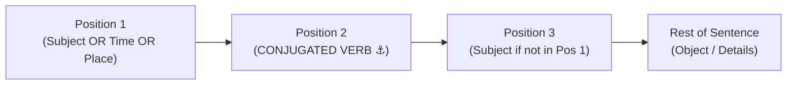

# Thursday - 19 November 2026
# 🇩🇪 Day 04: The V2 Word Order Rule & The Master Verbs (sein & haben)

- **Date:** Thursday, 19 Nov 2026  
- **Streak:** 🔥 **Day 4**  
- **Level:** Level 0 → A1.1  
- **Focus:** The Golden V2 Sentence Rule & Irregular Verbs *sein* (to be) and *haben* (to have)  

---

## 🎯 Today's Goals
1. Master the **Golden Law of German Grammar**: The **V2 Word Order Rule** (Position #2).
2. Conjugate and master the two most important verbs in the language: **sein** (to be) and **haben** (to have).
3. Express everyday physical states and feelings (*Hunger, Durst, Zeit, müde*).
4. Build flexible sentences where words can move around without breaking grammar.

---

## Part 1: The Golden Law: The V2 Rule (Verb in Position 2)

In English, word order is strictly: **Subject + Verb + Object** (*"Today I learn German"*).  
In German, the sentence has a magical anchor: **The conjugated verb is ALWAYS in Position #2** in a normal statement.

### Examples:
Look at how we can start with the **Subject** OR start with **Time** (*Heute* = today), and the verb **lerne** never moves from Position 2:

| Position 1 | Position 2 (VERB ⚓) | Position 3 | Position 4 (Rest) | English Meaning |
| :--- | :---: | :--- | :--- | :--- |
| **Ich** *(Subject)* | **lerne** | heute | Deutsch. | I learn German today. |
| **Heute** *(Time)* | **lerne** | **ich** *(Subject)* | Deutsch. | Today I learn German. |
| **In Berlin** *(Place)* | **wohne** | **ich**. | — | In Berlin I live. |

> [!IMPORTANT]
> **The Golden Law:** Whatever you put in Position 1 (a single word or a phrase like *In Deutschland*), **Position 2 belongs exclusively to the VERB**! If you don't start with *Ich*, the *Ich* simply hops right behind the verb to Position 3!

---

## Part 2: The Two Master Verbs: *sein* (to be) & *haben* (to have)

These two irregular verbs are the backbone of German conversation. Memorize them by heart:

### 1. The Verb **sein** (to be)
| Pronoun | German | English | Example | Meaning |
| :--- | :--- | :--- | :--- | :--- |
| **ich** | **bin** | I am | *Ich bin müde.* | I am tired. |
| **du** | **bist** | you are *(informal)* | *Du bist klug.* | You are smart. |
| **er / sie / es** | **ist** | he / she / it is | *Er ist Student.* | He is a student. |
| **wir** | **sind** | we are | *Wir sind hier.* | We are here. |
| **ihr** | **seid** | you all are | *Ihr seid nett.* | You all are nice. |
| **sie / Sie** | **sind** | they / **You (formal)** are | *Sie sind freundlich.* | You are friendly. |

---

### 2. The Verb **haben** (to have)
*(Notice: du and er/sie/es drop the 'b' from the stem hab-!)*

| Pronoun | German | English | Example | Meaning |
| :--- | :--- | :--- | :--- | :--- |
| **ich** | **habe** | I have | *Ich habe Zeit.* | I have time. |
| **du** | **hast** ⚠️ | you have *(informal)* | *Hast du Geld?* | Do you have money? |
| **er / sie / es** | **hat** ⚠️ | he / she / it has | *Sie hat ein Auto.* | She has a car. |
| **wir** | **haben** | we have | *Wir haben Hunger.* | We are hungry. |
| **ihr** | **habt** | you all have | *Habt ihr Fragen?* | Do you have questions? |
| **sie / Sie** | **haben** | they / **You (formal)** have | *Haben Sie Zeit?* | Do you have time? |

---

## Part 3: German Idioms with *haben* & *sein*

In German, several feelings that use "to be" in English actually use **haben** (to have) in German:

| English Thought | German Literal Form | German Sentence |
| :--- | :--- | :--- |
| "I am hungry" | I have hunger | *Ich habe Hunger.* |
| "I am thirsty" | I have thirst | *Ich habe Durst.* |
| "I have a question" | I have a question | *Ich habe eine Frage.* |
| "I am busy / in a hurry" | I have haste | *Ich habe Eile.* |
| "I am cold" | *(Unique structure)* | *Mir ist kalt.* (More on this in Dative!) |
| "I am tired" | Uses *sein* | *Ich bin müde.* |
| "I am ready" | Uses *sein* | *Ich bin bereit.* |

---

## ✍️ Interactive Checkpoint (Day 4 Drills)

Put today's engine to the test:

1. **The V2 Word Order Puzzle**:
   - Rearrange these words into a valid German sentence starting with **Heute** (Today):  
     `[ lerne ] [ ich ] [ Heute ] [ Deutsch ]`
2. **Fill in the blanks with *sein* or *haben***:
   - *Wie alt ______ du?* (Hint: *sein*)
   - *Ich ______ Hunger!* (Hint: *haben*)
   - *Wir ______ Studenten.* (Hint: *sein*)
   - *______ Sie eine Frage?* (Hint: *haben* - formal)
3. **Translate to German**:
   - *"Today I am tired, but I have time."*  
     *(Vocabulary: Heute = today, aber = but, müde = tired, Zeit = time)*
