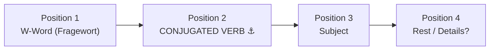
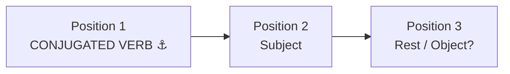
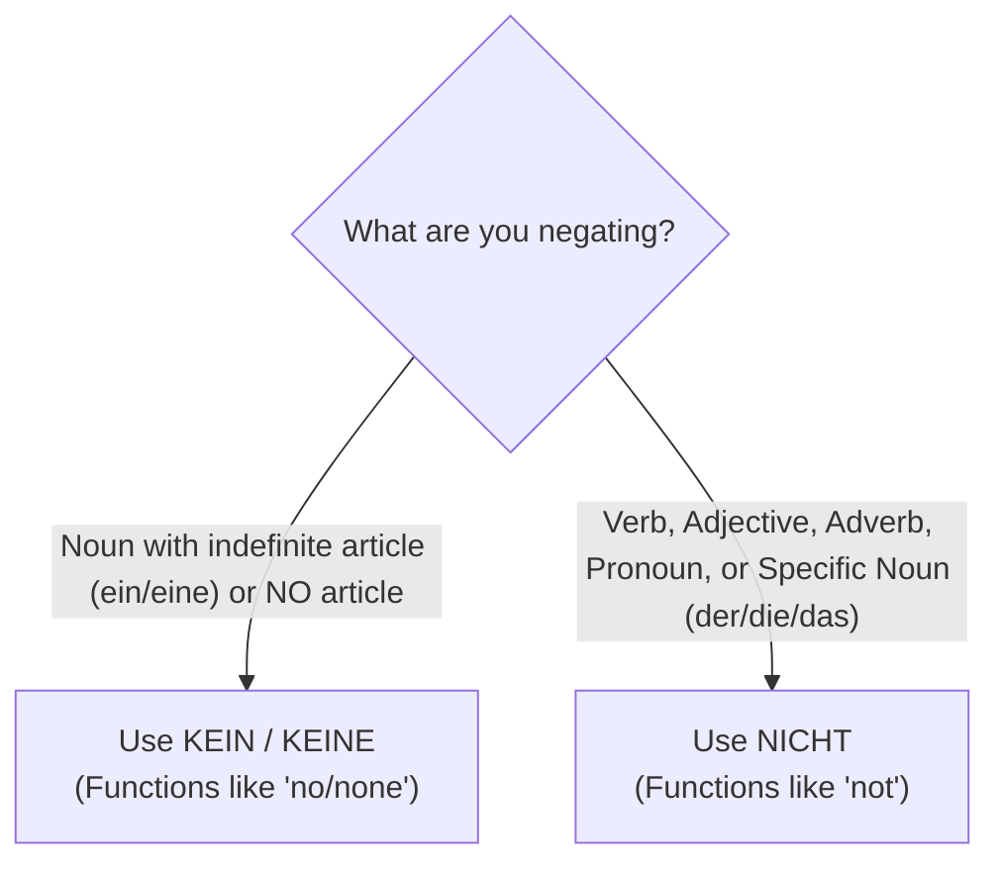

# Friday - 20 November 2026
# 🇩🇪 Day 05: Question Forming (W-Fragen vs. Ja/Nein Fragen) & Negation (nicht vs. kein)

- **Date:** Friday, 20 Nov 2026  
- **Streak:** 🔥 **Day 5**  
- **Level:** Level 0 → A1.1  
- **Focus:** Asking Open and Closed Questions & Negating with *nicht* and *kein*  

---

## 🎯 Today's Goals
1. Master **W-Fragen** (Open Questions) using the core interrogative question words.
2. Master **Ja/Nein-Fragen** (Closed Questions) using the Verb-First Inversion engine.
3. Understand the crucial distinction between **nicht** (not) and **kein** (no / none).
4. Confidently respond to questions with positive (*Ja*), negative (*Nein*), or clarifying (*Doch*) answers.

---

## Part 1: The Two Question Engines

In German, questions fall into two clear mathematical structures:

### 1. W-Fragen (Open-Ended Questions)
The question word sits at **Position 1**, and the **conjugated verb stays firmly at Position 2** (respecting the V2 rule).

| Pos 1 (W-Word) | Pos 2 (Verb ⚓) | Pos 3 (Subject) | Pos 4 (Rest) | English Meaning |
| :--- | :--- | :--- | :--- | :--- |
| **Woher** | **kommen** | Sie? | — | Where do you come from? |
| **Was** | **machst** | du | heute? | What are you doing today? |
| **Wo** | **wohnt** | er? | — | Where does he live? |

---

### 2. Ja/Nein-Fragen (Yes/No Questions: Verb Inversion)
When there is no W-word, the **Conjugated Verb takes the lead at Position 1**!

| Pos 1 (Verb ⚓) | Pos 2 (Subject) | Pos 3 (Rest) | English Meaning | Possible Answer |
| :--- | :--- | :--- | :--- | :--- |
| **Lernst** | du | Deutsch? | Do you learn German? | *Ja, ich lerne Deutsch.* |
| **Haben** | Sie | Zeit? | Do you have time? | *Nein, ich habe keine Zeit.* |
| **Bist** | du | müde? | Are you tired? | *Ja, ich bin müde.* |

---

## Part 2: The Core W-Question Words (Fragewörter)

Memorize these key interrogative tools:

| German W-Word | Pronunciation | English | Example Sentence | Meaning |
| :--- | :--- | :--- | :--- | :--- |
| **Wer** | [VAIR] | Who | *Wer ist das?* | Who is that? |
| **Was** | [VAHS] | What | *Was ist dein Name?* | What is your name? |
| **Wo** | [VOH] | Where *(static location)* | *Wo wohnst du?* | Where do you live? |
| **Woher** | [voh-HAIR] | Where from *(origin)* | *Woher kommen Sie?* | Where do you come from? |
| **Wohin** | [voh-HIN] | Where to *(direction)* | *Wohin gehst du?* | Where are you going? |
| **Wie** | [VEE] | How / What *(by what name)* | *Wie heißt du?* | What is your name? / How are you called? |
| **Wann** | [VAHN] | When | *Wann beginnt der Kurs?* | When does the class start? |
| **Warum** | [vah-ROOM] | Why | *Warum lernst du Deutsch?*| Why do you learn German? |

---

## Part 3: The Golden Negation Rule: *nicht* vs. *kein*

Beginners often get confused between **nicht** and **kein**. The rule is simple and absolute:

### 1. When to use **kein / keine**:
Use **kein** exclusively to negate a noun that would otherwise have **ein / eine** or **no article**:
- *Das ist ein Auto.* → *Das ist **kein** Auto.* (That is not a car / no car.)
- *Ich habe Zeit.* → *Ich habe **keine** Zeit.* (I have no time.)
- *Wir haben Hunger.* → *Wir haben **keinen** Hunger.* (We have no hunger.)

### 2. When to use **nicht**:
Use **nicht** for everything else:
- **Negating a Verb:** *Ich rauche **nicht**.* (I do not smoke.)
- **Negating an Adjective:** *Das Wasser ist **nicht** kalt.* (The water is not cold.)
- **Negating a definite noun (*der/die/das*):** *Das ist **nicht** mein Buch.* (That is not my book.)

> [!TIP]
> **The "Doch" Superpower:**
> If someone asks a negative question (*"Lernst du nicht Deutsch?"* - Aren't you learning German?) and you want to contradict it with "Yes, I DO!", you don't say *Ja*—you say **Doch!**  
> *"Lernst du nicht Deutsch?"* — *"**Doch**, ich lerne Deutsch!"*

---

## 💬 Real-Life Mini-Dialogue

**Lukas:** Hallo Sarah! Hast du heute Zeit?  
**Sarah:** Nein, Lukas. Ich habe heute leider **keine** Zeit.  
**Lukas:** Warum? Bist du müde?  
**Sarah:** Nein, ich bin **nicht** müde, aber ich lerne für eine Prüfung.  
**Lukas:** Verstehe! Wann hast du frei?  
**Sarah:** Morgen! Morgen habe ich frei.  

---

## ✍️ Interactive Checkpoint (Day 5 Drills)

Put today's knowledge to the test:

1. **Question Inversion Drill**:
   - Turn this statement into a Yes/No question:  
     *Du sprichst Deutsch.* ➡️ `?`
2. **Nicht or Kein Drill**:
   - Fill in the blank with the correct form of *nicht* or *kein / keine*:  
     a) *Ich habe ______ Auto.* (Auto is neuter: *ein Auto*)  
     b) *Der Kaffee ist ______ heiß.* (heiß = hot)
3. **Sentence Translation Prompt**:
   - Translate into German: *"Where do you live, and what is your name?"* (informal with *du*).
