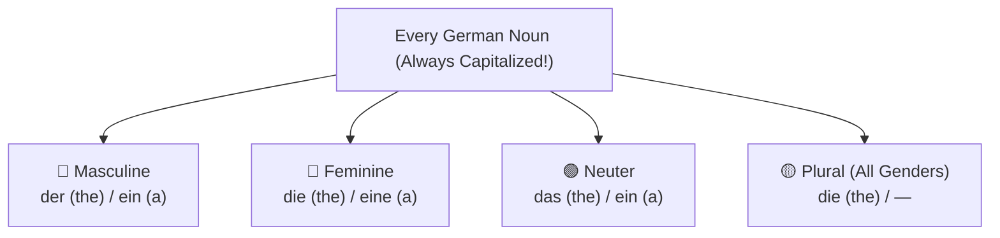

# Saturday - 21 November 2026
# 🇩🇪 Day 06: The Secret World of German Genders (*der*, *die*, *das*) & Articles

- **Date:** Saturday, 21 Nov 2026  
- **Streak:** 🔥 **Day 6**  
- **Level:** Level 0 → A1.1  
- **Focus:** Grammatical Gender (*der*, *die*, *das*), Suffix Cheat Codes & Definite vs. Indefinite Articles (*ein* / *eine*)  

---

## 🎯 Today's Goals
1. Understand the **3 Grammatical Genders** (*der*, *die*, *das*) and why German nouns are always capitalized.
2. Adopt the **Golden Habit**: Always memorize a noun together with its article (*der Tisch*, never just *Tisch*).
3. Unlock **Suffix Cheat Codes**—word endings that reliably reveal a noun's gender without guessing.
4. Connect **Definite ("the")**, **Indefinite ("a/an")**, and **Negative ("no")** articles into one unified formula.

---

## Part 1: The Three Articles (*der*, *die*, *das*) + Plural

In English, there is only one word for "the": **the**.  
In German, every noun belongs to one of **three grammatical buckets**—plus one shared bucket for **Plural**:



| Gender | Definite ("the") | Pronunciation | Example Noun | English Meaning |
| :--- | :---: | :--- | :--- | :--- |
| 🔵 **Masculine** | **der** | [DAIR] | *der Tisch* [dair TISH] | the table |
| 🔴 **Feminine** | **die** | [DEE] | *die Lampe* [dee LAHM-peh] | the lamp |
| 🟢 **Neuter** | **das** | [DAHS] | *das Buch* [dahs BOOKH] | the book |
| 🟡 **Plural** | **die** | [DEE] | *die Bücher* [dee BYOO-kher] | the books |

> [!WARNING]
> **Grammatical Gender ≠ Biological Sex!**  
> German gender belongs to the *word*, not the object's personality:
> - *der Löffel* (the spoon) is **masculine**
> - *die Gabel* (the fork) is **feminine**
> - *das Messer* (the knife) is **neuter**
> - *das Mädchen* (the girl) is **neuter** because of its `-chen` ending!
>
> **Golden Rule:** Never learn a naked noun like *Auto*. Always learn ***das** Auto*! Also remember: **every noun in German starts with a Capital Letter**.

---

## Part 2: The Gender Cheat Codes (Suffix & Category Secrets)

You don't have to memorize every word by blind luck. German word endings (**suffixes**) act like cheat codes that tell you the gender automatically:

### 🔵 Masculine Cheat Codes (**der**)
| Clue / Suffix | Examples | Meaning |
| :--- | :--- | :--- |
| **Male people & professions** | *der Mann*, *der Lehrer* [LAIR-er] | the man, the teacher |
| **Days, Months & Seasons** | *der Montag*, *der Juli*, *der Sommer* | Monday, July, summer |
| **Ending in `-er`** *(tools/doers)* | *der Computer*, *der Drucker* | the computer, the printer |
| **Ending in `-ismus` / `-ling`** | *der Tourismus*, *der Frühling* | tourism, spring |

### 🔴 Feminine Cheat Codes (**die**)
| Clue / Suffix | Reliability | Examples | Meaning |
| :--- | :---: | :--- | :--- |
| **Ending in `-ung`** | **100%** | *die Wohnung*, *die Zeitung* [TSY-toong] | the apartment, the newspaper |
| **Ending in `-heit` / `-keit`** | **100%** | *die Freiheit*, *die Möglichkeit* | freedom, possibility |
| **Ending in `-schaft`** | **100%** | *die Freundschaft* [FROYNT-shahft] | the friendship |
| **Ending in `-tion` / `-tät`** | **100%** | *die Information*, *die Universität* | information, university |
| **Female roles (`-in`)** | **100%** | *die Studentin*, *die Ärztin* | female student, female doctor |
| **Ending in `-e`** | **~90%** | *die Tasche*, *die Straße*, *die Blume* | bag, street, flower |

### 🟢 Neuter Cheat Codes (**das**)
| Clue / Suffix | Reliability | Examples | Meaning |
| :--- | :---: | :--- | :--- |
| **Ending in `-chen` / `-lein`** | **100%** | *das Mädchen*, *das Brötchen* [BROET-khen] | the girl, the bread roll |
| **Ending in `-ment` / `-um`** | **~98%** | *das Dokument*, *das Museum*, *das Zentrum* | document, museum, center |
| **Verb used as a Noun** | **100%** | *das Essen*, *das Lernen*, *das Trinken* | the food/eating, learning, drinking |
| **Languages & Colors** | **100%** | *das Deutsch*, *das Englisch*, *das Blau* | German, English, blue |

> [!TIP]
> **The Plural Shortcut:**  
> In the plural, gender disappears completely! Whether a word started as *der*, *die*, or *das*, the plural word for "the" is **always `die`**:  
> *der Tisch* → ***die** Tische* | *die Lampe* → ***die** Lampen* | *das Buch* → ***die** Bücher*

---

## Part 3: Definite ("the") vs. Indefinite ("a/an") vs. Negative ("no")

Yesterday (Day 05) you learned *kein / keine*. Look at how cleanly **der / die / das**, **ein / eine**, and **kein / keine** snap together into one grid (for subjects and after *sein*):

| Gender | Definite ("the") | Indefinite ("a / an") | Negative ("no / not a") | Example Sentence |
| :--- | :---: | :---: | :---: | :--- |
| 🔵 **Masculine** | **der** | **ein** | **kein** | *Das ist **ein** Kaffee, **kein** Tee.* |
| 🔴 **Feminine** | **die** | **eine** | **keine** | *Das ist **eine** Tasche, **keine** Jacke.* |
| 🟢 **Neuter** | **das** | **ein** | **kein** | *Das ist **ein** Buch, **kein** Heft.* |
| 🟡 **Plural** | **die** | *(none)* | **keine** | *Das sind Bücher, **keine** Zeitungen.* |

```
Formula:
  Masculine (der) & Neuter (das)  ──▶  ein  / kein   (NO -e ending!)
  Feminine  (die) & Plural (die)  ──▶  eine / keine  (Add -e ending!)
```

> [!IMPORTANT]
> **Notice the Symmetry!**  
> Right now (in the **Nominative** case—used for the subject and after *sein*), **Masculine** and **Neuter** both use **ein** and **kein**. Only **Feminine** (and Plural *keine*) adds the **-e**! *(Tomorrow in Day 07, we will see what happens when Masculine becomes a direct object!)*

---

## 💬 Real-Life Mini-Dialogue

**Mia:** Hallo Tim! Was ist das auf dem Tisch? *(What is that on the table?)*  
**Tim:** Das ist **ein** Brötchen und **eine** Zeitung.  
**Mia:** Und ist das **ein** Tee?  
**Tim:** Nein, das ist **kein** Tee. Das ist **ein** Kaffee!  
**Mia:** Super! Und wo ist **das** Buch für den Kurs?  
**Tim:** Hier in **der** Tasche! *(Here in the bag!)*  

---

## ✍️ Interactive Checkpoint (Day 6 Drills)

Put today's gender cheat codes to the test:

1. **Suffix Cheat-Code Check**:
   - Using the suffix rules from Part 2, choose the correct definite article (**der**, **die**, or **das**):  
     a) `______` **Zeitung** *(newspaper)*  
     b) `______` **Brötchen** *(bread roll)*  
     c) `______` **Museum** *(museum)*  
2. **Definite → Indefinite Conversion**:
   - Change **"the"** (*der / die / das*) into **"a / an"** (*ein / eine*):  
     a) *Das ist **der** Computer.* ➡️ *Das ist `______` Computer.*  
     b) *Das ist **die** Wohnung.* ➡️ *Das ist `______` Wohnung.*  
     c) *Das ist **das** Auto.* ➡️ *Das ist `______` Auto.*  
3. **Sentence Translation Prompt**:
   - Translate into German:  
     *"That is a book, not a newspaper."*  
     *(Vocabulary: Das ist = That is, das Buch = book, die Zeitung = newspaper; use **kein/keine** for "not a"!)*
