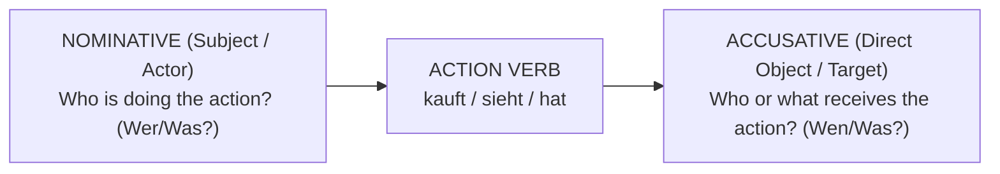

# Sunday - 22 November 2026
# 🇩🇪 Day 07: The Accusative Case (Direct Objects) & *den / einen / keinen*

- **Date:** Sunday, 22 Nov 2026  
- **Streak:** 🔥 **Day 7**  
- **Level:** Level 0 → A1.1  
- **Focus:** Nominative vs. Accusative Case, Direct Objects, the *der → den* Shift & Accusative Trigger Verbs  

---

## 🎯 Today's Goals
1. Understand the difference between the **Nominative** (the Subject / Actor) and the **Accusative** (the Direct Object / Target).
2. Master the **One-Row Shift**: why **only Masculine** changes (`der → den`, `ein → einen`, `kein → keinen`) while Feminine, Neuter, and Plural stay identical.
3. Avoid the classic **Verb *sein* Trap** (knowing when *not* to use Accusative).
4. Use high-frequency **Accusative trigger verbs** (*haben, kaufen, suchen, trinken, essen, sehen*) in everyday sentences.

---

## Part 1: Subject vs. Direct Object (Nominative vs. Accusative)

In English, word order tells us who is acting and who is receiving the action (*"The man sees the dog"* vs. *"The dog sees the man"*).  
In German, **cases** mark each noun's role directly inside its article:



- **Nominative (The Actor):** *Der Mann* kauft einen Kaffee. *(Who is buying? **Der Mann** → Subject)*
- **Accusative (The Target):** Der Mann kauft *einen Kaffee*. *(What is he buying? **einen Kaffee** → Direct Object)*

> [!TIP]
> **The "Wen oder Was?" Litmus Test:**  
> Ask **"Whom or what?"** (*Wen oder was?*) right after the verb. Whatever directly answers that question is in the **Accusative Case**!  
> - *Ich trinke **einen Tee**.* → What am I drinking? **einen Tee** (Accusative!).

---

## Part 2: The Golden *der → den* Shift (90% Easier Than You Think!)

Here is the best news in German grammar: out of all four buckets (Masculine, Feminine, Neuter, Plural), **three of them do not change at all** in the Accusative!

**Formula:** $\text{Only Masculine shifts: } der \rightarrow den \mid ein \rightarrow einen \mid kein \rightarrow keinen$

| Gender | Nominative (Subject) | Accusative (Direct Object) | What Changed? | Accusative Example |
| :--- | :---: | :---: | :---: | :--- |
| 🔵 **Masculine** | **der / ein / kein** | **den / einen / keinen** | **YES! (`-n` / `-en`)** | *Ich habe **einen** Bruder.* |
| 🔴 **Feminine** | die / eine / keine | die / eine / keine | *No change* | *Ich habe **eine** Schwester.* |
| 🟢 **Neuter** | das / ein / kein | das / ein / kein | *No change* | *Ich habe **ein** Auto.* |
| 🟡 **Plural** | die / — / keine | die / — / keine | *No change* | *Ich habe **keine** Bücher.* |

```
Quick Memory Cheat Code:
  Masculine Nominative:  deR  | eiN    | keiN
  Masculine Accusative:  deN  | eiNeN  | keiNeN   (Every masculine article ends in -N!)
```

> [!WARNING]
> **The Verb *sein* (to be) Trap!**  
> The verb **sein** (*ich bin, du bist, er/sie/es ist, das ist*) acts like an **equals sign (`=`)**, NOT an action targeting an object. Therefore, **sein NEVER triggers Accusative**—both sides stay Nominative!  
> - ✅ *Das ist **ein** Kaffee.* *(That = a coffee → Nominative!)*  
> - ✅ *Ich trinke **einen** Kaffee.* *(I drink [target] a coffee → Accusative!)*  
> - ❌ *Das ist ~~einen~~ Kaffee.* *(Wrong! Never use `einen` after `ist`!)*

---

## Part 3: Core Accusative Trigger Verbs & Pronouns

Almost all everyday action verbs take a direct object in the **Accusative**. Here are your essential A1 Accusative triggers:

| German Verb | Pronunciation | English | Example (with Masculine Noun) | Meaning |
| :--- | :--- | :--- | :--- | :--- |
| **haben** | [HAH-ben] | to have | *Ich habe **keinen** Hunger.* | I have no hunger (I'm not hungry). |
| **kaufen** | [KOW-fen] | to buy | *Er kauft **den** Tisch.* | He buys the table. |
| **trinken** | [TRIN-ken] | to drink | *Wir trinken **einen** Kaffee.* | We drink a coffee. |
| **essen** | [ES-sen] | to eat | *Du isst **einen** Apfel.* | You eat an apple. |
| **suchen** | [ZOO-khen] | to look for | *Sie sucht **den** Schlüssel.* | She is looking for the key. |
| **brauchen** | [BROW-khen] | to need | *Ich brauche **einen** Stift.* | I need a pen. |
| **sehen** | [ZAY-en] | to see | *Siehst du **den** Hund?* | Do you see the dog? |
| **lesen** | [LAY-zen] | to read | *Ich lese **einen** Text.* | I am reading a text. |

### Bonus: Accusative Personal Pronouns (*me, you, him...*)
When replacing a person or masculine noun with a pronoun as the direct object:

| Nominative (Subject) | Accusative (Object) | Pronunciation | Example |
| :--- | :--- | :--- | :--- |
| **ich** (I) | **mich** (me) | [MIKH] | *Siehst du **mich**?* (Do you see me?) |
| **du** (you) | **dich** (you) | [DIKH] | *Ich verstehe **dich**.* (I understand you.) |
| **er** (he / masc. it) | **ihn** (him / it) | [EEN] | *Der Kaffee? Ich trinke **ihn**!* (I drink it!) |
| **sie** (she) / **es** (it) | **sie** / **es** | [ZEE] / [ES] | *Ich kenne **sie**.* (I know her.) |

---

## 💬 Real-Life Mini-Dialogue

**Lukas:** Guten Morgen, Mia! Suchst du **den** Schlüssel [SHLYOO-sel]? *(Are you looking for the key?)*  
**Mia:** Nein, ich habe **den** Schlüssel schon. Aber ich brauche **einen** Kaffee!  
**Lukas:** Das ist **ein** Problem—wir haben leider **keinen** Kaffee mehr. *(We have no more coffee.)*  
**Mia:** Oh nein! Und hast du vielleicht **einen** Tee oder **ein** Wasser?  
**Lukas:** Ja! Ich habe **einen** grünen Tee und **ein** Brötchen für **dich**.  
**Mia:** Danke, Lukas! Du bist **ein** echter Freund! *(You are a true friend!)*  

---

## ✍️ Interactive Checkpoint (Day 7 Drills)

Test your mastery of the Accusative Case (`der → den`, `ein → einen`, `kein → keinen`):

1. **The *sein* vs. Action Verb Trap**:
   - Choose the correct article (**ein** or **einen**) for *der Computer* (masculine):  
     a) *Das ist `______` Computer.*  
     b) *Ich kaufe `______` Computer.*  
2. **Fill-in-the-Blank (Accusative Shift Check)**:
   - Complete each sentence with the right form of *der/den*, *ein/einen*, or *kein/keinen*:  
     a) *Ich trinke `______` Tee, aber ich habe `______` Zucker.* *(both **der** Tee and **der** Zucker are masculine; use "a" and "no")*  
     b) *Wir suchen `______` Wohnung.* *(die Wohnung = feminine; use "an")*  
     c) *Er liest `______` Buch.* *(das Buch = neuter; use "the")*  
3. **Active Sentence Translation**:
   - Translate into German:  
     *"I have a dog (der Hund), and I need a coffee (der Kaffee)."*  
     *(Hint: Check the gender of both nouns—both are masculine!)*
