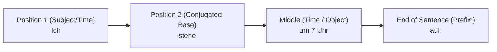

# Monday - 23 November 2026
# 🇩🇪 Day 08: Daily Routine, Telling Time & Separable Verbs

- **Date:** Monday, 23 Nov 2026  
- **Streak:** 🔥 **Day 8**  
- **Level:** Level 0 → A1.1  
- **Focus:** Telling Time (*Wie spät ist es?*), Time Prepositions (*um*, *am*), & Separable Verbs (*trennbare Verben*)  

---

## 🎯 Today's Goals
1. Ask and tell the time in German using both the **official 24-hour clock** and **casual everyday expressions** (*Viertel nach*, *halb*).
2. Master the essential **Time Prepositions** (**um** for exact clock times, **am** for days & parts of the day).
3. Unlock **Separable Verbs** (*trennbare Verben*) like *aufstehen* and *einkaufen* using the **Bracket Split Formula**.
4. Combine time expressions, V2 word order, and separable verbs to describe your daily routine from morning to night.

---

## Part 1: Telling Time (*Wie spät ist es?*)

To ask for the time in German, use either of these two common questions:
- **Wie spät ist es?** [VEE SHPAYT ist es] *(Literally: "How late is it?")*
- **Wie viel Uhr ist es?** [VEE feel OOR ist es] *(Literally: "How much clock is it?")*

**Formula (Official / 24-Hour Time):** $\text{Es ist [Hour] Uhr [Minutes].}$

In official contexts (train schedules, TV, appointments), German uses the **24-hour clock**. In everyday speech with friends, it uses the **12-hour clock** with *Viertel* (quarter), *nach* (past), *vor* (to), and *halb* (half).

| Time | Official (24-Hour) | Casual / Everyday (12-Hour) | Pronunciation & Meaning |
| :--- | :--- | :--- | :--- |
| **08:00** | *Es ist acht Uhr.* | *Es ist acht (Uhr).* | [akht OOR] — 8:00 |
| **08:15** | *Es ist acht Uhr fünfzehn.* | *Es ist **Viertel nach** acht.* | [FEER-tel nahkh akht] — Quarter past 8 |
| **08:30** | *Es ist acht Uhr dreißig.* | *Es ist **halb neun**.* | [halp NOYN] — **Halfway to 9** (8:30!) |
| **08:45** | *Es ist acht Uhr fünfundvierzig.* | *Es ist **Viertel vor** neun.* | [FEER-tel for noyn] — Quarter to 9 |
| **14:20** | *Es ist vierzehn Uhr zwanzig.* | *Es ist zwanzig **nach** zwei.* | [TSVAN-tsikh nahkh tsvai] — 2:20 PM |
| **20:00** | *Es ist zwanzig Uhr.* | *Es ist acht Uhr abends.* | [akht OOR AH-bents] — 8:00 PM |

> [!WARNING]
> **The Classic *halb* Trap!**  
> In English, *"half nine"* (UK) means 9:30. In German, **halb** looks forward to the **NEXT hour**!  
> - *Es ist **halb neun**.* = Halfway **TO** nine = **8:30** ✅ (NOT 9:30 ❌)  
> - *Es ist **halb zwei**.* = Halfway **TO** two = **1:30** ✅ (NOT 2:30 ❌)

---

## Part 2: Time Prepositions (*um* vs. *am*) & V2 Inversion

When talking about *when* something happens (*Wann?*), German pairs specific prepositions with specific time units:

| Preposition | Used For | Examples | Pronunciation |
| :--- | :--- | :--- | :--- |
| **um** | Exact clock times | *um 7 Uhr*, *um halb acht* | [um ZEE-ben OOR] — at 7 o'clock |
| **am** *(an + dem)* | Days of the week & parts of the day | *am Montag*, *am Morgen*, *am Abend* | [am MOHN-tahk] — on Monday / in the morning |
| **in der** | **Exception:** Nighttime! | *in der Nacht* | [in der NAKHT] — at night |

### Key Daily Time Words
- **der Morgen** [MOR-gen] (morning) → *am Morgen* / *morgens* (in the mornings)
- **der Mittag** [MIT-tahk] (noon) → *am Mittag* / *mittags* (at noon)
- **der Nachmittag** [NAHKH-mit-tahk] (afternoon) → *am Nachmittag* (in the afternoon)
- **der Abend** [AH-bent] (evening) → *am Abend* / *abends* (in the evening)
- **die Nacht** [nakht] (night) → *in der Nacht* (at night)

> [!TIP]
> **Remember the V2 Rule with Time First!**  
> If you start a sentence with a time expression (Position 1), the **conjugated verb MUST stay in Position 2**, pushing the subject to Position 3:  
> - Standard: *Ich trinke **um 8 Uhr** einen Kaffee.*  
> - Time-First: ***Um 8 Uhr** trinke **ich** einen Kaffee.* ✅ *(Never: "Um 8 Uhr ich trinke...")*

---

## Part 3: Separable Verbs (*Trennbare Verben*) — The Bracket Split

Many everyday German routine verbs have a **prefix** glued to a base verb (like *auf + stehen* = to get up). In a normal statement, this verb **splits in two**:
1. The **conjugated base verb** sits in **Position 2**.
2. The **prefix** flies all the way to the **very END** of the sentence—creating a grammatical bracket (*Satzklammer*).

**Formula:** $\text{Position 1} + \underbrace{\text{Base Verb}_{\text{Pos 2}}}_{\text{conjugated}} + \text{Time / Object} + \underbrace{\text{Prefix}}_{\text{End!}}$

| Infinitive | Prefix + Base | Pronunciation | Meaning | Sentence Example |
| :--- | :--- | :--- | :--- | :--- |
| **aufstehen** | *auf \| stehen* | [OWF-shtay-en] | to get up | *Ich **stehe** um 7 Uhr **auf**.* |
| **anfangen** | *an \| fangen* | [AN-fang-en] | to start / begin | *Die Arbeit **fängt** um 9 Uhr **an**.* *(a → ä for du/er/sie/es)* |
| **einkaufen** | *ein \| kaufen* | [EYN-kow-fen] | to go shopping | *Wir **kaufen** am Abend **ein**.* |
| **fernsehen** | *fern \| sehen* | [FERN-zay-en] | to watch TV | *Er **sieht** abends **fern**.* *(e → ie for du/er/sie/es)* |
| **aufräumen** | *auf \| räumen* | [OWF-roy-men] | to tidy up | *Ich **räume** mein Zimmer **auf**.* |
| **anrufen** | *an \| rufen* | [AN-roo-fen] | to call (on phone) | *Sie **ruft** mich um 18 Uhr **an**.* |
| **mitkommen** | *mit \| kommen* | [MIT-kom-en] | to come along | ***Kommst** du heute **mit**?* |
| **einschlafen** | *ein \| schlafen* | [EYN-shlah-fen] | to fall asleep | *Das Kind **schläft** um 21 Uhr **ein**.* *(a → ä for du/er/sie/es)* |

> [!TIP]
> **How to Spot a Separable Prefix:**  
> Prefixes like **ab-**, **an-**, **auf-**, **aus-**, **ein-**, **fern-**, **mit-**, and **zurück-** are always **stressed** when pronounced: **AUF**stehen, **EIN**kaufen, **AN**rufen. If the stress is on the prefix, it splits!

---

## 💬 Real-Life Mini-Dialogue

**Jonas:** Guten Morgen, Lena! Wann **stehst** du normalerweise **auf**? *(When do you usually get up?)*  
**Lena:** **Am** Montag **stehe** ich schon **um** halb sieben **auf**. Mein Deutschkurs **fängt** **um** acht Uhr **an**.  
**Jonas:** Oh, das ist früh! Und was machst du **am** Nachmittag?  
**Lena:** **Um** siebzehn Uhr **kaufe** ich im Supermarkt **ein**. **Kommst** du **mit**?  
**Jonas:** Gern! Ich **rufe** dich **um** Viertel vor fünf **an**.  
**Lena:** Super! Bis später!

---

## ✍️ Interactive Checkpoint (Day 8 Drills)

Test your mastery of German Time, Prepositions, and Separable Verbs:

1. **The Clock & Preposition Trap Check**:
   - Look at the digital clock **`07:30`** and choose the correct German phrase:  
     a) *Es ist halb sieben.*  
     b) *Es ist halb acht.*  
   - Choose the right preposition (**um**, **am**, or **in der**):  
     *"Ich schlafe `______` Nacht, aber `______` Morgen trinke ich Kaffee `______` 8 Uhr."*

2. **Fill-in-the-Blank (The Bracket Split)**:
   - Split and conjugate the separable verb in parentheses to complete each sentence:  
     a) *Wir `______` am Samstag im Supermarkt `______`.* (**einkaufen**)  
     b) *Um 9 Uhr `______` der Unterricht `______`.* (**anfangen** — *watch the stem vowel change `a → ä` for 3rd person singular!*)  
     c) *`______` du heute ins Kino `______`?* (**mitkommen**)

3. **Active Sentence Translation**:
   - Translate into German using **Time-First V2 Inversion** and a **separable verb**:  
     *"At 7:30, I get up, and in the evening I watch TV."*  
     *(Hint: Start with "Um halb acht..." and remember where the verb and prefix go!)*
