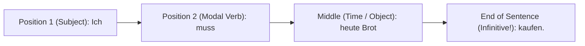

# Tuesday - 24 November 2026
# 🇩🇪 Day 09: Food, Supermarket & Modal Verbs (*können*, *müssen*, *möchten*)

- **Date:** Tuesday, 24 Nov 2026  
- **Streak:** 🔥 **Day 9**  
- **Level:** Level 0 → A1.1  
- **Focus:** Modal Verbs (*können*, *müssen*, *möchten*), The Modal Bracket Formula, & Supermarket Vocabulary  

---

## 🎯 Today's Goals
1. Master the **"Big 3" Modal Verbs** (*können* = can, *müssen* = must/have to, *möchten* = would like) and their unique **1st/3rd-person singular rule**.
2. Lock in the **Modal Bracket Formula** (*Satzklammer*): conjugated modal in Position 2, infinitive verb kicked to the **very end**.
3. Learn essential **Food & Supermarket** vocabulary with their genders (`der`, `die`, `das`) and packaging quantities.
4. Combine modal verbs and Day 7's **Accusative Case** to shop and order politely in real life.

---

## Part 1: The "Big 3" Modal Verbs (*Modalverben*)

Modal verbs act like **power boosters** for other verbs. Instead of just saying *"I buy bread"* (*Ich kaufe Brot*), they express **ability** (*können*), **necessity** (*müssen*), or **polite desire** (*möchten*).

Here is the conjugation engine for the Big 3:

| Pronoun | **können** *(can / be able to)* | **müssen** *(must / have to)* | **möchten** *(would like)* |
| :--- | :--- | :--- | :--- |
| **ich** | **kann** [kan] | **muss** [mus] | **möchte** [MÖKH-teh] |
| **du** | **kannst** [kanst] | **musst** [must] | **möchtest** [MÖKH-test] |
| **er / sie / es** | **kann** [kan] | **muss** [mus] | **möchte** [MÖKH-teh] |
| **wir** | **können** [KÖN-en] | **müssen** [MÜS-en] | **möchten** [MÖKH-ten] |
| **ihr** | **könnt** [könt] | **müsst** [müst] | **möchtet** [MÖKH-tet] |
| **sie / Sie** | **können** [KÖN-en] | **müssen** [MÜS-en] | **möchten** [MÖKH-ten] |

> [!TIP]
> **The "Shoe Pattern" Cheat Code!**  
> Look closely at the **singular** column (`ich`, `du`, `er/sie/es`) vs. the **plural** column (`wir`, `ihr`, `sie/Sie`):  
> 1. **`ich` and `er/sie/es` are 100% IDENTICAL** and drop the usual `-e` and `-t` endings in *können* and *müssen*! (*Ich **kann**, er **kann** — NOT "ich könne" or "er kannt"!*)  
> 2. **Stem vowel change in the singular "shoe":** `ö → a` (*können → kann*) and `ü → u` (*müssen → muss*), while the plurals keep the original umlaut (*wir können*, *wir müssen*).  
> 3. **Politeness Hack:** Always use **möchte** (*would like*) instead of *will* (*want*) when ordering food or asking for something—it sounds warm and natural!

---

## Part 2: The Modal Bracket Formula (*Satzklammer*)

Just like yesterday's separable verbs, German modal verbs create a **sentence bracket** (*Satzklammer*).  
1. The **conjugated modal verb** sits in **Position 2**.
2. All time words and objects go in the **middle**.
3. The **second verb (main action)** stays in its **pure infinitive (`-en`) form** and gets kicked to the **VERY END** of the sentence!

**Formula:** $\text{Position 1} + \underbrace{\text{Modal Verb}_{\text{Pos 2}}}_{\text{conjugated}} + \text{Time / Object} + \underbrace{\text{Main Verb}_{\text{Infinitive}}}_{\text{End!}}$

### Modal Verbs in Action
- *Ich **kann** gut Deutsch **sprechen**.* *(I can speak German well.)*
- *Wir **müssen** heute im Supermarkt **einkaufen**.* *(We have to go shopping in the supermarket today.)*
- *Er **möchte** einen Kaffee **trinken**.* *(He would like to drink a coffee.)*
- ***Kannst** du mir bitte **helfen**?* *(Can you help me, please?)* — Yes/No question: Modal in Position 1, Infinitive still at the end!

> [!WARNING]
> **Separable Verbs + Modal Verbs = Reunited at the End!**  
> Yesterday we learned that *einkaufen* splits into *kaufe ... ein*.  
> When a **modal verb** takes Position 2, the separable verb stays **glued together** as one infinitive at the end:  
> - Alone: *Ich **kaufe** um 17 Uhr **ein**.* ✅  
> - With modal: *Ich **muss** um 17 Uhr **einkaufen**.* ✅ *(Never: "Ich muss kaufe ein"!)*

---

## Part 3: Food, Supermarket & Polite Shopping (*im Supermarkt*)

Let's pack your virtual shopping basket with high-frequency A1 nouns. Notice the genders (`der`, `die`, `das`) because **masculine nouns (`der`) change to `den` / `einen` / `keinen`** when you buy or want them (Accusative Case from Day 7)!

### Essential Food & Drink Vocabulary

| German (Singular / Plural) | Pronunciation | English | Accusative Example (*Ich möchte...*) |
| :--- | :--- | :--- | :--- |
| **der Apfel** *(die Äpfel)* | [AP-fel] | apple | *Ich möchte **einen** Apfel.* |
| **der Käse** *(—)* | [KAY-zeh] | cheese | *Ich kaufe **den** Käse.* |
| **der Kaffee** *(—)* | [KAF-ay] | coffee | *Wir trinken **einen** Kaffee.* |
| **die Banane** *(die Bananen)* | [bah-NAH-neh] | banana | *Sie nimmt **eine** Banane.* |
| **die Milch** *(—)* | [milkh] | milk | *Ich brauche **eine** Milch.* |
| **die Tomate** *(die Tomaten)* | [toh-MAH-teh] | tomato | *Er möchte **Tomaten**.* |
| **das Brot** *(die Brote)* | [broht] | bread | *Ich kaufe **ein** Brot.* |
| **das Wasser** *(—)* | [VAS-er] | water | *Wir möchten **ein** Wasser.* |
| **das Ei** *(die Eier)* | [ai / AI-er] | egg / eggs | *Ich brauche sechs **Eier**.* |

### Handy Packaging & Supermarket Phrases
- **eine Flasche Wasser** [EY-neh FLAH-sheh VAS-er] — a bottle of water
- **ein Stück Käse** [eyn shtük KAY-zeh] — a piece of cheese
- **eine Packung Milch** [EY-neh PAK-ung milkh] — a carton/pack of milk
- **ein Kilo Äpfel** [eyn KEE-loh EP-fel] — one kilo of apples
- **Was kostet das?** [vas KOS-tet das] — How much does that cost?
- **Ich hätte gern...** [ikh HET-eh gern] — I would like to have... *(super natural alternative to "Ich möchte")*
- **Sonst noch etwas?** [zonst nokh ET-vas] — Anything else? *(What the cashier asks you!)*
- **Nein danke, das ist alles.** [nayn DANG-keh, das ist AL-es] — No thanks, that is all.
- **Mit Karte, bitte.** [mit KAR-teh, BIT-eh] — By card, please. / **Bar, bitte.** [bar] — Cash, please.

---

## 💬 Real-Life Mini-Dialogue (*Im Supermarkt*)

**Kassiererin (Cashier):** Guten Tag! **Kann** ich Ihnen helfen? *(Good day! Can I help you?)*  
**Lukas:** Ja, gern! Wo **kann** ich hier Käse und frisches Brot **finden**?  
**Kassiererin:** Das Brot ist links, und der Käse ist dort rechts.  
**Lukas:** Danke! *(At the checkout later)* Ich **möchte** bitte **ein** Brot, **einen** Apfel und eine Flasche Wasser **kaufen**.  
**Kassiererin:** Gern. Sonst noch etwas?  
**Lukas:** Nein danke, das ist alles. **Kann** ich mit Karte **bezahlen**?  
**Kassiererin:** Natürlich! Das macht 5 Euro 40.

---

## ✍️ Interactive Checkpoint (Day 9 Drills)

Test your mastery of Modal Verbs, the Bracket Formula, and Supermarket German:

1. **The Modal "Shoe Pattern" & Bracket Trap Check**:
   - Choose the **only** grammatically correct sentence:  
     a) *Er kannt sehr gut Deutsch sprechen.*  
     b) *Er kann sehr gut Deutsch spricht.*  
     c) *Er kann sehr gut Deutsch sprechen.*  
   - Why? Explain in one short phrase!

2. **Fill-in-the-Blank (Modal Conjugation + Bracket + Accusative)**:
   - Complete each sentence with the right **conjugated modal verb** and **infinitive** (and watch the Accusative article in `c`):  
     a) *Wir `______` heute Abend im Supermarkt `______`.* (**müssen** + **einkaufen**)  
     b) *`______` du mir bitte `______`?* (**können** + **helfen**)  
     c) *Ich `______` `______` Kaffee und `______` Brot `______`.* (**möchten** + **ein** *der Kaffee* + **ein** *das Brot* + **kaufen**)

3. **Active Sentence Translation**:
   - Translate into German using a **modal verb** and the **infinitive at the end**:  
     *"I would like to buy two bananas and a piece of cheese. Can I pay by card?"*
