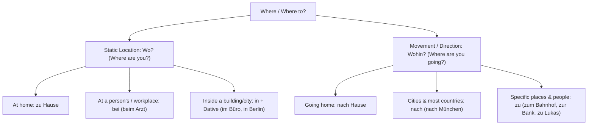

# Wednesday - 25 November 2026
# 🇩🇪 Day 10: The Dative Case (*mit*, *zu*, *bei*) & Direction Prepositions

- **Date:** Wednesday, 25 Nov 2026  
- **Streak:** 🔥 **Day 10**  
- **Level:** Level 0 → A1.1  
- **Focus:** The Dative Case (`dem / der / dem / den`), Dative Pronouns (`mir`, `dir`, `Ihnen`), & Direction/Location Prepositions (*mit*, *zu*, *bei*, *nach*, *aus*, *von*, *seit*)  

---

> 🎉 **Milestone Unlocked: 10-Day Streak & Phase 5!**  
> You have completed Phases 0 through 4. Today we enter **Phase 5**—giving your German real-world precision with **where you are**, **where you are going**, and **who you are doing things with or for**.

---

## 🎯 Today's Goals
1. Unlock the **Dative Case** article transformation table (`der/das → dem`, `die → der`, `die (pl) → den + -n`).
2. Master Dative personal pronouns (`mir`, `dir`, `ihm`, `ihr`, `uns`, `euch`, `ihnen/Ihnen`) and spot why Day 9's *"Kannst du **mir** helfen?"* uses Dative.
3. Learn the core **Always-Dative Prepositions** (*mit*, *zu*, *bei*, *nach*, *aus*, *von*, *seit*) and their everyday contractions (`zum`, `zur`, `beim`, `vom`).
4. Distinguish **Location (`Wo?`)** vs. **Direction (`Wohin?`)** cleanly (including the classic *zu Hause* vs. *nach Hause* rule).

---

## Part 1: The Dative Case Engine (*Der Dativ*)

In Day 7, we learned that the **Accusative Case** marks the **direct object** (the *thing* receiving the action: *Ich kaufe **einen** Apfel*).  
The **Dative Case** answers two core questions:
1. **"To whom / For whom?"** (*Wem?*) — the indirect recipient (*Ich gebe **dem** Freund das Brot*).
2. **Location / Triggered by Dative Prepositions** (*Wo? / Mit wem?* — *Ich fahre mit **dem** Bus*).

### The Golden Dative Article Transformation

| Gender | Nominative (Subject) | **Dative Definite** (*the*) | **Dative Indefinite** (*a / no*) | Example (*mit ...*) |
| :--- | :--- | :--- | :--- | :--- |
| **Masculine** *(der)* | der / ein / kein | **dem** [dehm] | **einem / keinem** | *mit **dem** Bus / mit **einem** Freund* |
| **Feminine** *(die)* | die / eine / keine | **der** [dehr] ⚠️ | **einer / keiner** | *mit **der** U-Bahn / mit **einer** Freundin* |
| **Neuter** *(das)* | das / ein / kein | **dem** [dehm] | **einem / keinem** | *mit **dem** Auto / mit **einem** Taxi* |
| **Plural** *(die)* | die / — / keine | **den** + **`-n`** on noun | **— / keinen** + **`-n`** | *mit **den** Kinder**n** / mit **den** Freunde**n*** |

**Formula Cheat Code (`M-R-M-N`):**  
$$\text{Dative Endings} = \underbrace{\text{de}\mathbf{m}}_{\text{Masc.}} \quad|\quad \underbrace{\text{de}\mathbf{r}}_{\text{Fem.}} \quad|\quad \underbrace{\text{de}\mathbf{m}}_{\text{Neut.}} \quad|\quad \underbrace{\text{de}\mathbf{n} + \text{Noun}\mathbf{-n}}_{\text{Plural}}$$

> [!WARNING]
> **Two Classic Dative Traps to Watch Out For!**  
> 1. **Feminine `die` flips to `der`!** Seeing `der` in *zur (= zu **der**) Schule* or *mit **der** Bahn* does NOT mean the noun is masculine—it means a feminine noun (*die Schule*, *die Bahn*) is in the Dative!  
> 2. **Plural Dative adds an `-n` to the noun** (unless the plural already ends in `-n` or `-s`, like *die Autos*): *die Kinder → mit den Kinder**n***, *die Freunde → mit den Freunde**n***.

### Dative Personal Pronouns (*Dativpronomen*)
Yesterday you saw *Kann ich **Ihnen** helfen?* and *Kannst du **mir** helfen?*. Verbs like **helfen** (to help), **danken** (to thank), **gefallen** (to please/like), and **gehören** (to belong to) always take Dative pronouns:

| Nominative | **Dative Pronoun** | Pronunciation | Real-Life Mini-Phrase |
| :--- | :--- | :--- | :--- |
| ich | **mir** | [meer] | *Hilfst du **mir**?* *(Will you help me?)* |
| du | **dir** | [deer] | *Wie geht es **dir**?* *(How are you? / How is it going for you?)* |
| er / es | **ihm** | [eem] | *Ich danke **ihm**.* *(I thank him.)* |
| sie (she) | **ihr** | [eer] | *Das Buch gehört **ihr**.* *(The book belongs to her.)* |
| wir | **uns** | [oons] | *Kommst du mit **uns**?* *(Are you coming with us?)* |
| ihr (you pl.) | **euch** | [oykh] | *Ich helfe **euch**.* *(I'm helping you all.)* |
| sie / Sie | **ihnen / Ihnen** | [EE-nen] | *Kann ich **Ihnen** helfen?* *(Can I help you? [formal])* |

---

## Part 2: The "Always-Dative" Prepositions (*mit, zu, bei, nach, aus, von, seit*)

Whenever one of these prepositions appears, the noun or pronoun right after it is **100% locked into the Dative Case**—no exceptions!

| Preposition | Pronunciation | Core Meaning | Built-In Contractions | Example Sentence |
| :--- | :--- | :--- | :--- | :--- |
| **mit** | [mit] | with / by (transport) | — | *Ich fahre **mit dem** Zug.* *(I travel by train.)* |
| **zu** | [tsoo] | to (a person, shop, local place) | **zu + dem = zum** [tsoom] **zu + der = zur** [tsoor] | *Ich gehe **zum** Bahnhof / **zur** Arbeit.* *(I'm going to the station / to work.)* |
| **bei** | [bay] | at (someone's home, workplace, near) | **bei + dem = beim** [baym] | *Ich wohne **bei meinen** Eltern. Er ist **beim** Arzt.* *(I live with my parents. He's at the doctor's.)* |
| **nach** | [nakh] | to (cities/countries) / after (time) | — | *Wir fliegen **nach** Berlin. **Nach** dem Essen...* *(We fly to Berlin. After the meal...)* |
| **aus** | [ows] | from (origin/country) / out of | — | *Ich komme **aus** Bangladesch / **aus der** Schweiz.* *(I come from Bangladesh / from Switzerland.)* |
| **von** | [fon] | from (a person/place) / of | **von + dem = vom** [fom] | *Das Geschenk ist **von** Anna. Ich komme **vom** Büro.* *(The gift is from Anna. I'm coming from the office.)* |
| **seit** | [zayt] | since / for (time continuing now) | — | *Ich lerne **seit einem** Monat Deutsch.* *(I have been learning German for one month.)* |

> [!TIP]
> **Power Contraction Formula (`+ dem = -m`, `+ der = -r`):**  
> Germans almost never say *"zu dem"* or *"bei dem"* in everyday speech—they glue them together:
> - `zu + dem` = **`zum`** (*zum Supermarkt*, *zum Arzt*)
> - `zu + der` = **`zur`** (*zur Bank*, *zur Universität*)
> - `bei + dem` = **`beim`** (*beim Bäcker*, *beim Frühstück*)
> - `von + dem` = **`vom`** (*vom Bahnhof*, *vom Kurs*)
> - *(Bonus static location contraction)* `in + dem` = **`im`** (*im Supermarkt* = in the supermarket)

---

## Part 3: Location (`Wo?`) vs. Direction (`Wohin?`) Cheat Sheet

Choosing between **zu**, **nach**, and **bei / in** is one of the biggest A1 breakthroughs. Use this decision map:

### The Famous **"Home" Pair** (Memorize This!)
- **Static (`Wo?` — Where are you?):** *Ich bin **zu Hause**.* [tsoo HOW-zeh] *(I am at home.)*
- **Movement (`Wohin?` — Where are you going?):** *Ich gehe **nach Hause**.* [nakh HOW-zeh] *(I am going home.)*

> [!WARNING]
> **Never use `nach` for shops or people!**  
> - ❌ *Ich gehe nach Supermarkt.* / ❌ *Ich gehe nach meinem Freund.*  
> - ✅ *Ich gehe **zum** Supermarkt.* / ✅ *Ich gehe **zu** meinem Freund.*  
> Use **nach** ONLY for **cities, continents, countries without articles** (*nach Berlin*, *nach Deutschland*), compass directions (*nach links / nach rechts*), and **nach Hause**.

---

## 💬 Real-Life Mini-Dialogue (*Unterwegs in der Stadt* — Out & About in the City)

**Sara:** Hallo Lukas! Wohin gehst du jetzt?  
**Lukas:** Hallo Sara! Ich gehe **zum** Bahnhof und fahre **mit dem** Zug **nach** Hamburg.  
**Sara:** Ach, toll! Wohnst du dort **bei** deiner Familie?  
**Lukas:** Ja, ich bleibe drei Tage **bei meinen** Eltern. Und was machst du heute?  
**Sara:** Ich muss **zur** Arbeit gehen, aber um 18 Uhr fahre ich **mit der** U-Bahn **nach Hause**.  
**Lukas:** Alles klar! Viel Spaß **beim** Arbeiten und bis nächste Woche!

---

## ✍️ Interactive Checkpoint (Day 10 Drills)

Test your mastery of the Dative Case, Pronouns, and Prepositions:

1. **The Dative Trap & Preposition Check**:
   - Choose the **only** grammatically correct sentence:  
     a) *Ich gehe nach der Bank und dann zu Hause.*  
     b) *Ich gehe zur Bank und dann nach Hause.*  
     c) *Ich gehe zum Bank und dann zu Hause.*  
   - Why? Explain in one short phrase! *(Hint: check the gender of `die Bank` and movement vs. static!)*

2. **Fill-in-the-Blank (Dative Articles, Contractions & Pronouns)**:
   - Complete each sentence with the right Dative form or contraction:  
     a) *Er fährt jeden Morgen `______` `______` Bus zur Uni.* (**mit** + *der Bus*)  
     b) *Ich gehe um 16 Uhr `______` Arzt und danach `______` Supermarkt.* (**zu + dem** / **zu + dem**)  
     c) *Kannst du `______` bitte helfen? Ich komme heute spät `______` Hause.* (**ich** in Dative + **to** home)

3. **Quick Sentence Prompt**:
   - Write **one** German sentence combining **mit** (a transport mode) and **zu** (`zum` or `zur`) or **nach** (a city).  
     *(Example idea: "I go to work by bus" or "We travel to Berlin by train.")*

---

## 📝 Daily Assignment (Hausaufgabe)

Complete all 3 tasks below and reply in the chat with your answers so I can grade them and keep your **🔥 Day 10** streak going!

1. **Article & Contraction Builder (4 items):**  
   Convert the noun in brackets into the **Dative Case** (use contractions like `zum`, `zur`, `beim`, `vom` where natural):  
   a) *Wir sprechen mit `______`.* (**die Lehrerin**)  
   b) *Sie geht zu `______`.* (**die Apotheke** — *pharmacy*)  
   c) *Ich komme gerade von `______`.* (**das Büro**)  
   d) *Er spielt mit `______`.* (**die Kinder** — *plural!*)

2. **Mini-Paragraph Translation (English → German):**  
   Translate these 3 connected sentences into German using today's Dative prepositions:  
   > *"I have been living in Munich for two months (`seit zwei Monaten`). Every day I go to work by subway (`die U-Bahn`). After work (`die Arbeit`), I go home and cook with my friend (`mein Freund`)."*

3. **Personal Daily Output (3 Original Sentences):**  
   Write **3 original German sentences** about your own day or weekend using:  
   - Sentence 1: **mit** + a mode of transport or a person (*e.g., mit dem Bus, mit meinem Bruder*)  
   - Sentence 2: **zu** (`zum` / `zur` / `zu`) or **nach** (*a place, city, or home*)  
   - Sentence 3: **bei** or **seit** + a Dative pronoun or noun (*e.g., bei mir, seit einem Jahr*)

> *Reply here with your Checkpoint + Hausaufgabe answers whenever you're ready!*
