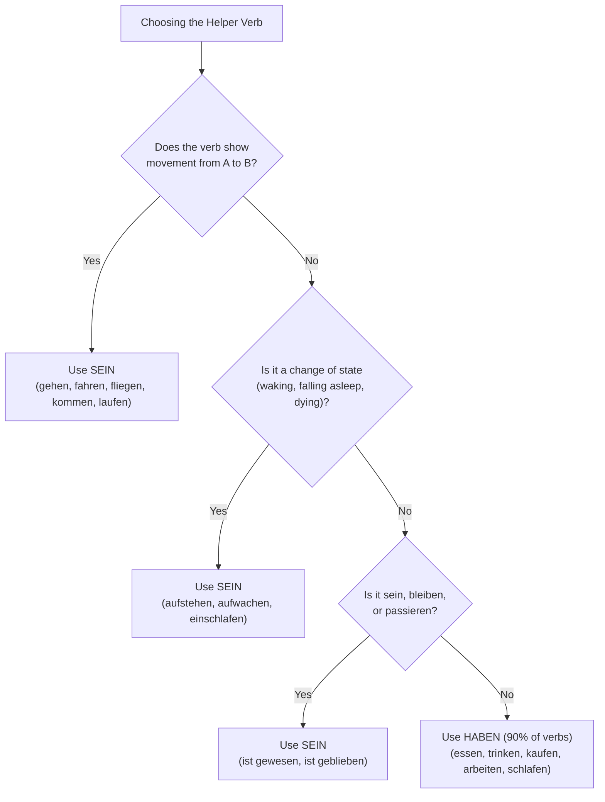

# Thursday - 26 November 2026
# 🇩🇪 Day 11: Speaking in the Past (*Perfekt* Tense with *haben* & *sein*)

- **Date:** Thursday, 26 Nov 2026  
- **Streak:** 🔥 **Day 11**  
- **Level:** A1.1 → A1.2 (Phase 5 Finale!)  
- **Focus:** Spoken Past Tense (*Das Perfekt*), the Sentence Bracket (*Satzklammer*), Building *Partizip II* (`ge-...-t` / `ge-...-en`), and Choosing **haben** vs. **sein**

---

> 🏆 **Phase 5 Finale: Unlocking Time Travel!**  
> Until today, your German has lived completely in the present tense. Today you unlock the **Perfekt**—the #1 past tense Germans actually use in everyday conversation, texts, and storytelling (*"What did you do yesterday?"*).

---

## 🎯 Today's Goals
1. Master the **Perfekt Sentence Bracket** (*Satzklammer*): conjugated helper verb in **Position 2**, *Partizip II* at the **very end**.
2. Build *Partizip II* forms cleanly across all 4 A1 patterns (regular `ge-...-t`, separable `prefix-ge-...-t`, no-`ge-` verbs like `-iert` / `be-` / `ver-`, and core irregular `-en` verbs).
3. Know immediately when to choose **`haben`** vs. **`sein`** as your helper verb (movement A→B, state change, and `sein`/`bleiben`).
4. Talk smoothly about what you ate, drank, bought, and where you went yesterday (*gestern*).

---

## Part 1: The *Perfekt* Sentence Bracket (*Die Satzklammer*)

Good news: if you mastered Modal Verbs on Day 9 (*Ich **kann** gut Deutsch **sprechen***), you already know the exact word order for the German past tense!

$$\text{Position 1 (Subject/Time)} \;+\; \underbrace{\text{Position 2 (haben / sein)}}_{\text{Conjugated!}} \;+\; \text{Middle (Time / Place / Object)} \;+\; \underbrace{\text{END (Partizip II)}}_{\text{Unchanged!}}$$

Compare **Present with Modal (Day 9)** vs. **Past with *Perfekt* (Day 11)**:
- *Ich **möchte** heute einen Kaffee **trinken**.* *(I would like to drink a coffee today.)*
- *Ich **habe** gestern einen Kaffee **getrunken**.* [ikh HAH-beh GES-tern AY-nen KAF-feh geh-TROON-ken] *(I drank a coffee yesterday.)*

And remember the **V2 Rule** (Day 4): if you put **gestern** (*yesterday*) in Position 1, the subject moves right behind the helper verb:
- *Gestern **habe** ich einen Kaffee **getrunken**.* ✅
- ❌ *Gestern ich habe einen Kaffee getrunken.* (Breaks V2!)

---

## Part 2: Building *Partizip II* — The 4 Core Patterns

The **Partizip II** is the past participle at the end of the sentence (like English *bought*, *eaten*, *gone*). It never changes for *ich/du/wir*.

### Pattern 1: Regular Verbs (`ge-` + stem + `-t`)
| Infinitive | Pronunciation | Stem | **Partizip II** | Example |
| :--- | :--- | :--- | :--- | :--- |
| **machen** *(to do/make)* | [MAKH-en] | mach- | **gemacht** [geh-MAKHT] | *Was hast du **gemacht**?* |
| **kaufen** *(to buy)* | [KOW-fen] | kauf- | **gekauft** [geh-KOWFT] | *Ich habe Brot **gekauft**.* |
| **lernen** *(to learn)* | [LER-nen] | lern- | **gelernt** [geh-LERNT] | *Wir haben Deutsch **gelernt**.* |
| **spielen** *(to play)* | [SHPEE-len] | spiel- | **gespielt** [geh-SHPEELT] | *Er hat Fußball **gespielt**.* |
| **arbeiten** *(to work)* | [AR-bay-ten] | arbeit- | **gearbeitet** [geh-AR-bay-tet] | *Sie hat lange **gearbeitet**.* *(extra `-e-` after `-t/-d`)* |

### Pattern 2: Separable Verbs (`prefix` + `ge-` + stem + `-t / -en`)
Remember Day 8's separable prefixes (`ein-`, `auf-`, `an-`, `fern-`)? The **`ge-`** squeezes right **between** the prefix and the verb!
- **einkaufen** *(to shop)* → **ein** + **ge** + **kauft** = **eingekauft** [AYN-geh-kowft]
- **aufstehen** *(to get up)* → **auf** + **ge** + **standen** = **aufgestanden** [OWF-geh-shtan-den]
- **anrufen** *(to call)* → **an** + **ge** + **rufen** = **angerufen** [AN-geh-roo-fen]

### Pattern 3: The "NO `ge-`" VIP Club (`-iert` & `be- / er- / ver-`)
> [!WARNING]
> **Huge A1 Trap: Never add `ge-` to verbs ending in `-iert` or starting with `be-`, `er-`, `ver-`, `ge-`!**  
> - ❌ *Ich habe Deutsch **gestudiert**.* / ❌ *Ich habe das **gebezahlt**.*  
> - ✅ *Ich habe Deutsch **studiert**.* [shtoo-DEERT] *(I studied German.)*  
> - ✅ *Ich habe die Rechnung **bezahlt**.* [beh-TSAHLT] *(I paid the bill.)*  
> - ✅ *Hast du mich **verstanden**?* [fer-SHTAN-den] *(Did you understand me?)*  
> - ✅ *Ich habe meine Familie **besucht**.* [beh-ZOOKHT] *(I visited my family.)*

### Pattern 4: High-Frequency Irregular Verbs (`ge-` + vowel shift + `-en`)
| Infinitive | Meaning | **Partizip II** | Pronunciation | Mini-Sentence |
| :--- | :--- | :--- | :--- | :--- |
| **essen** | to eat | **gegessen** | [geh-GES-en] | *Ich habe Pizza **gegessen**.* |
| **trinken** | to drink | **getrunken** | [geh-TROON-ken] | *Wir haben Tee **getrunken**.* |
| **sehen** | to see / watch | **gesehen** | [geh-ZEH-en] | *Hast du den Film **gesehen**?* |
| **lesen** | to read | **gelesen** | [geh-LEH-zen] | *Sie hat ein Buch **gelesen**.* |
| **schreiben** | to write | **geschrieben** | [geh-SHREE-ben] | *Ich habe eine E-Mail **geschrieben**.* |
| **sprechen** | to speak | **gesprochen** | [geh-SHPROKH-en] | *Er hat mit Anna **gesprochen**.* |
| **schlafen** | to sleep | **geschlafen** | [geh-SHLAH-fen] | *Ich habe gut **geschlafen**.* |
| **nehmen** | to take | **genommen** | [geh-NOM-en] | *Sie hat den Bus **genommen**.* |

---

## Part 3: *haben* vs. *sein* — Which Helper Verb Do I Use?

90% of German verbs use **`haben`**. You only switch to **`sein`** (`bin, bist, ist, sind, seid, sind`) when the verb shows **movement from A to B**, a **change of state**, or belongs to the **3 static exceptions**.

### The Essential `sein`-Verbs for A1
| Infinitive | Meaning | **Perfekt (3rd Person)** | Pronunciation | Example |
| :--- | :--- | :--- | :--- | :--- |
| **gehen** | to go (on foot) | **ist gegangen** | [ist geh-GANG-en] | *Ich **bin** nach Hause **gegangen**.* |
| **fahren** | to go (by vehicle) | **ist gefahren** | [ist geh-FAH-ren] | *Wir **sind** mit dem Zug **gefahren**.* |
| **fliegen** | to fly | **ist geflogen** | [ist geh-FLOH-gen] | *Er **ist** nach Berlin **geflogen**.* |
| **kommen** | to come | **ist gekommen** | [ist geh-KOM-en] | *Wann **bist** du **gekommen**?* |
| **aufstehen** | to get up | **ist aufgestanden** | [ist OWF-geh-shtan-den] | *Ich **bin** um 7 Uhr **aufgestanden**.* |
| **bleiben** | to stay | **ist geblieben** | [ist geh-BLEE-ben] | *Sie **ist** zu Hause **geblieben**.* |
| **sein** | to be | **ist gewesen** | [ist geh-VEH-zen] | *Ich **bin** im Kino **gewesen**.* |

> [!TIP]
> **Spoken German Pro Shortcut for *sein* & *haben* in the Past:**  
> Even though *ist gewesen* and *hat gehabt* exist, native speakers almost always use the simple past forms **war** (*was*) and **hatte** (*had*) in everyday speech!
> - **war** [vahr]: *Ich **war** gestern müde.* *(I was tired yesterday.)* — *Wir **waren** im Supermarkt.* *(We were at the supermarket.)*
> - **hatte** [HAH-teh]: *Ich **hatte** keine Zeit.* *(I had no time.)* — *Er **hatte** Hunger.* *(He was hungry.)*

---

## 💬 Real-Life Mini-Dialogue (*Was hast du gestern gemacht?* — What did you do yesterday?)

**Lukas:** Hallo Sara! Wie **war** dein Mittwoch? Was **hast** du gestern **gemacht**?  
**Sara:** Hallo Lukas! Ich **bin** früh **aufgestanden** und **bin** mit dem Bus zur Uni **gefahren**.  
**Lukas:** Und was **hast** du danach **gemacht**?  
**Sara:** Am Nachmittag **habe** ich Deutsch **gelernt** und **habe** im Supermarkt **eingekauft**. Und du?  
**Lukas:** Ich **hatte** viel Arbeit im Büro. Am Abend **habe** ich Pasta **gekocht** und einen Film **gesehen**.  
**Sara:** Klingt gut! Ich **bin** um 22 Uhr nach Hause **gegangen** und **habe** super **geschlafen**.

---

## ✍️ Interactive Checkpoint (Day 11 Drills)

Test your mastery of the *Perfekt* tense before tackling the assignment:

1. **The "NO `ge-`" & `sein`-Verb Trap**:
   - Choose the **only** grammatically correct sentence:  
     a) *Ich habe gestern nach München gefahrt und dort Deutsch gestudiert.*  
     b) *Ich bin gestern nach München gefahren und habe dort Deutsch studiert.*  
     c) *Ich bin gestern nach München gefahren und bin dort Deutsch studiert.*  
   - Why are the other two wrong? *(Identify the two specific mistakes!)*

2. **Fill-in-the-Blank (Auxiliary + *Partizip II*)**:
   - Complete each sentence with **`haben`** or **`sein`** (conjugated) + the right **Partizip II**:  
     a) *Wir `______` gestern im Café einen Tee `______`.* (**trinken**)  
     b) *Um 8 Uhr `______` mein Bruder mit dem Zug `______`.* (**kommen**)  
     c) *`______` du heute schon im Supermarkt `______`?* (**einkaufen**)

3. **Quick Sentence Prompt**:
   - Write **one** German sentence in the *Perfekt* starting with **`Gestern`** (watch the V2 rule!) using **`bin ... gegangen`** or **`bin ... gefahren`**.  
     *(Example idea: "Yesterday I went to the supermarket" or "Yesterday I traveled to Berlin by train.")*

---

## 📝 Daily Assignment (Hausaufgabe)

Complete all 3 tasks below and reply in the chat with your answers so I can grade them and keep your **🔥 Day 11** streak going!

1. **Partizip II & Helper Verb Builder (4 items):**  
   Fill in the correct conjugated helper verb (**`haben`** or **`sein`**) and the **Partizip II**:  
   a) *Ich `______` gestern meine Freunde `______`.* (**besuchen** — *careful: `be-` prefix!*)  
   b) *Sie (she) `______` um 6:30 Uhr `______`.* (**aufstehen** — *separable + state change!*)  
   c) *Ihr `______` gestern eine lange E-Mail `______`.* (**schreiben**)  
   d) *Er `______` am Wochenende zu Hause `______`.* (**bleiben** — *check the flowchart!*)

2. **Mini-Paragraph Translation (English → German):**  
   Translate these 3 connected sentences into German using the **Perfekt** (and **war/hatte** where natural):  
   > *"Yesterday I got up at 7 o'clock and drank a coffee. Then I went to work by bus. In the evening (`am Abend`), I cooked rice (`Reis`) and read a book."*

3. **Personal Daily Output (3 Original Sentences):**  
   Write **3 original German sentences** about what you actually did yesterday or earlier this week:  
   - Sentence 1: Something you **ate, drank, bought, or learned** (using **`haben`**)  
   - Sentence 2: Somewhere you **went or traveled** (using **`sein`** + Day 10 Dative prepositions like `mit dem Bus`, `zum`, `zur`, `nach`)  
   - Sentence 3: One sentence using **`war`** or **`hatte`** (e.g., where you were or what you had)

> *Reply here with your Checkpoint + Hausaufgabe answers whenever you're ready!*
